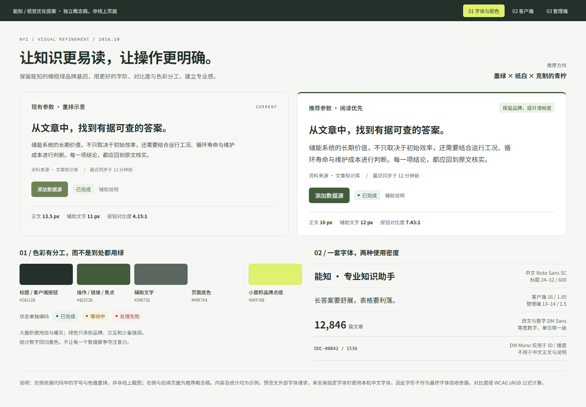
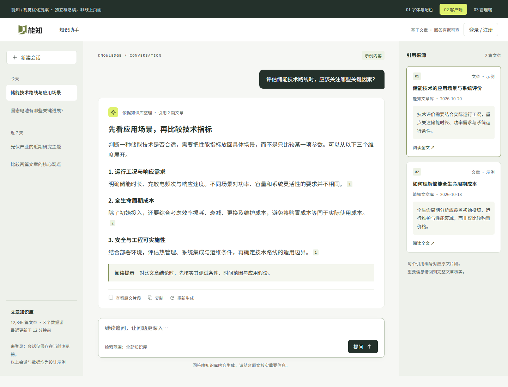
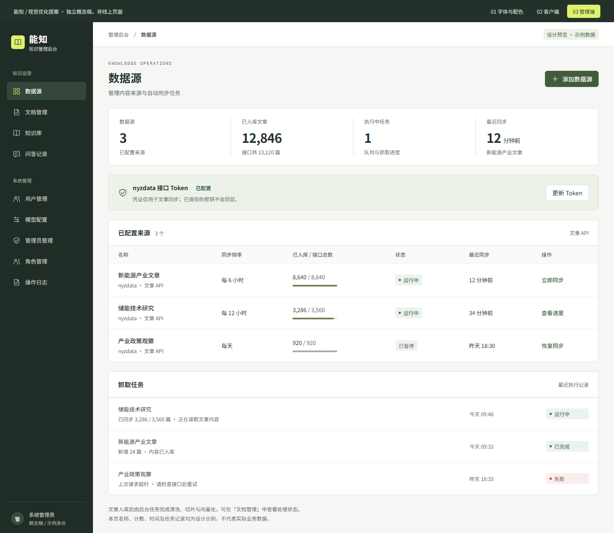
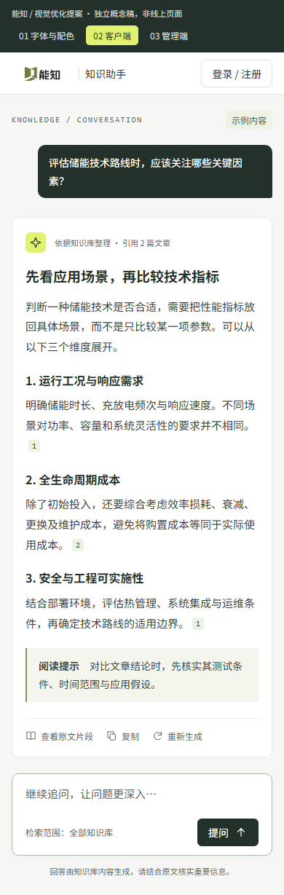
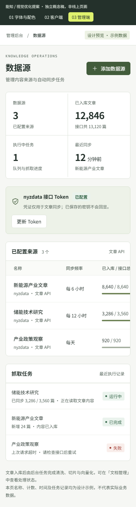

# 能知客户端与管理端 UI 字体及配色建议

日期：2026-10-25  
范围：客户端与管理端的字体、字号、配色及视觉层级  
状态：已按第八、九节在正式应用落地（字体、配色、字号层级）；效果图仍为独立概念稿

## 一、结论

建议保留现有的墨绿、橄榄绿品牌方向，不必换成常见的蓝紫色科技风。

当前更需要改善的是字号、文字对比度和颜色分工，而不是增加装饰。推荐方向为：**墨绿 × 纸白 × 小面积青柠**。

- 客户端侧重持续阅读：正文舒展，引用清楚，周边信息适当弱化。
- 管理端侧重操作效率：数据清晰，层级紧凑，主操作和异常状态容易辨认。
- 两端共享品牌与字体，但不必采用完全相同的信息密度。

## 二、现状与问题

以下判断来自现有代码中的样式参数，不等同于完整的线上视觉或无障碍审计。

| 问题 | 当前情况 | 影响 |
| --- | --- | --- |
| 阅读字号偏小 | 客户端回答正文为 13.5px，部分辅助信息仅 10–11px | 不利于持续阅读专业内容 |
| 辅助文字偏淡 | `#737D76` 在页面底色 `#F7F8F6` 上对比度约 4.00:1 | 低于普通小字号文字的 WCAG AA 4.5:1 要求 |
| 管理端按钮对比度不足 | `#6F8357` 配白字，对比度约 4.15:1 | 小字号按钮文字不够清晰 |
| 绿色承担的角色较多 | 品牌、强调、成功状态均采用接近的绿色 | 需要更清晰地区分交互与状态 |
| 字体加载依赖外部服务 | 两端通过 Google Fonts 加载字体 | 加载失败时可能出现字形与排版漂移 |

### 现有样式位置

- [共享主题与字体](../../packages/ui/src/theme.css)
- [管理端主题覆盖](../../apps/admin/src/style.css)
- [客户端样式](../../apps/web/src/style.css)
- [客户端回答正文](../../apps/web/src/components/AnswerMarkdown.vue)
- [客户端字体加载入口](../../apps/web/index.html)
- [管理端字体加载入口](../../apps/admin/index.html)

## 三、字体建议

现有 **Noto Sans SC + DM Sans** 可以继续使用。中文产品的专业感，更多来自稳定的字阶、字重与行距，而不是更换一款特别的字体。

| 使用位置 | 建议字体或参数 | 说明 |
| --- | --- | --- |
| 中文字体 | Noto Sans SC | 回退到苹方、微软雅黑 |
| 英文与数字 | DM Sans | 与中文字体搭配，保持界面统一 |
| 客户端回答正文 | 桌面 16px / 1.85 | 优先保证长答案阅读体验 |
| 手机端回答正文 | 15–16px / 1.8 | 不因屏幕变小而过度缩小正文 |
| 管理端表格主要内容 | 14px / 1.5 | 标题、名称等核心字段优先清晰 |
| 管理端表格次要字段 | 13px / 1.5 | 日期、来源等可适度紧凑 |
| 日期、来源、辅助说明 | 通常不低于 12px | 不要再叠加透明度降低对比 |
| 页面标题 | 24–32px / 600 | 按页面层级调整，避免满屏粗体 |
| 正文常规字重 | 400 | 小标题或重要信息使用 500–600 |
| ID、模型维度、技术参数 | DM Mono | 不用于中文正文与说明 |

表中的 `16px / 1.85` 表示字号 16px、行高为字号的 1.85 倍。

### 数字排版

- 统计数字使用 `font-variant-numeric: tabular-nums`，减少数值变化带来的视觉跳动。
- 数值与单位分层，例如数字使用 28–32px，单位使用 12–14px。
- 不必把所有统计数字设为绿色；常态数据使用墨色，把强调色留给真正需要注意的内容。

### 字体加载

正式落地时建议自托管经过分包的 WOFF2 字体，并保留 `font-display: swap` 与系统字体回退。

中文字体需注意文件体积，不宜为了少数字重加载完整的大体积字体包。上线前应检查字体加载前后的布局稳定性，以及 Windows、macOS 和移动端的实际呈现。

## 四、配色建议

### 基础色板

| 用途 | 推荐颜色 | 使用原则 |
| --- | --- | --- |
| 标题、客户端主按钮 | `#24312B` | 稳重、清晰，形成视觉重心 |
| 管理端主按钮、链接、焦点 | `#425C3B` | 深橄榄绿，保证交互辨识度 |
| 正文 | `#36443C` | 与标题拉开层级，但不显灰淡 |
| 辅助文字 | `#59675E` | 用于来源、日期、说明等信息 |
| 页面背景 | `#F6F7F4` | 接近纸白的浅灰底色 |
| 卡片背景 | `#FFFFFF` | 与页面背景形成轻量分层 |
| 侧面板背景 | `#EEF1EB` | 用于会话侧栏与引用区域 |
| 常规分隔线 | `#DCE2D8` | 用于轻量结构分隔，不代表所有控件边界均已满足对比要求 |
| 品牌点缀 | `#DFF16E` | 用于小图标底色、选中态等，不用于浅底正文 |

### 状态色

| 状态 | 文字颜色 | 浅色背景 | 使用要求 |
| --- | --- | --- | --- |
| 成功 | `#326347` | `#EAF3ED` | 配合“已完成”等明确文字 |
| 等待或警告 | `#855B1E` | `#FBF1DF` | 配合“等待中”等明确文字 |
| 失败或错误 | `#A13D35` | `#F9EEEB` | 配合“失败”“处理失败”等明确文字 |

状态不能只靠颜色判断。正式组件应同时提供文字；需要时使用具有不同形状的图标，帮助用户识别异常。

### 对比度核算

以下数值按 WCAG sRGB 相对亮度公式计算，针对表中明确列出的前景与背景组合。

| 组合 | 对比度 | 说明 |
| --- | --- | --- |
| 当前辅助文字 `#737D76` / 白色 | 4.26:1 | 不足普通文字 AA 4.5:1 |
| 当前辅助文字 `#737D76` / 当前页面底色 `#F7F8F6` | 4.00:1 | 不足普通文字 AA 4.5:1 |
| 当前管理端按钮白字 / `#6F8357` | 4.15:1 | 不足普通文字 AA 4.5:1 |
| 推荐辅助文字 `#59675E` / 白色 | 5.95:1 | 达到普通文字 AA 对比度要求 |
| 推荐辅助文字 `#59675E` / 推荐底色 `#F6F7F4` | 5.54:1 | 达到普通文字 AA 对比度要求 |
| 推荐管理端按钮白字 / `#425C3B` | 7.43:1 | 达到普通文字 AAA 对比度阈值 |
| 成功文字 / 对应浅色背景 | 6.16:1 | 达到普通文字 AA 对比度要求 |
| 等待文字 / 对应浅色背景 | 5.34:1 | 达到普通文字 AA 对比度要求 |
| 失败文字 / 对应浅色背景 | 5.71:1 | 达到普通文字 AA 对比度要求 |

这些结果不代表整个界面已通过 WCAG 验收。透明度、悬停态、禁用态、输入框边界、焦点可见性等仍需单独检查。

## 五、双端应用原则

### 客户端：阅读优先

- 放大长答案正文，控制单行长度，避免过宽或过密。
- 保持回答区白色、周边区域浅灰，让内容成为视觉中心。
- 引用编号、来源标题与原文入口使用稳定一致的样式。
- 主按钮保留深墨绿，青柠色仅作为小面积品牌点缀。
- 重要提示不依赖极浅的文字颜色，说明信息应当真正可读。

### 管理端：辨识优先

- 保留深色侧栏，主内容使用浅色背景与白色卡片。
- 主操作采用深橄榄绿，避免普通按钮、状态标签和所有统计数字同等突出。
- 表格核心字段使用 14px，次要字段使用 13px 左右。
- 失败状态明确使用错误色与文字，不与待处理、重复等状态共用模糊的灰色表达。
- 窄屏表格可保留内部横向滚动，但页面本身不应横向溢出。

## 六、效果图

### 字体与配色对比

左侧依据现有代码参数重排，右侧为推荐方案。此图不是线上页面前后截图。

### 客户端推荐效果

放大长答案正文，弱化周边区域，让回答与引用成为主角。

### 管理端推荐效果

保留深色侧栏，统计数字回归墨色，主操作使用深橄榄绿，失败状态单独突出。

### 移动端效果

手机端为窄屏视觉示意，不代表完整的移动端交互方案。

## 七、预览与验证范围

- [完整 HTML 设计稿](index.html)：可切换字体配色、客户端、管理端三个视图。
- [字体与配色移动端图](mobile-guide.png)
- 桌面效果已通过本机 Chrome 渲染并检查。
- 已使用真实 390px 仿真视口检查三个预览视图，页面整体无横向溢出。
- 管理端表格保留内部横向滚动。
- 示例页面不连接业务接口，按钮仅提示其为视觉概念稿。
- 所有文章内容、会话、名称、统计与任务记录均为设计示例，不代表实际业务数据。
- 预览未下载外部字体，实际字形取决于本机可用字体；效果图主要用于确认字号层级、色彩与整体方向，不作为最终字体字形验收依据。
- 概念稿阶段未修改正式应用；落地情况见第十节。

## 八、评审补充（2026-10-25）

对照代码复核后，第二、四节的现状判断与对比度数值均成立（按同一公式重算一致）。以下为补充与修正。

### 1. 字体加载的风险高于“字形漂移”

两端 `index.html` 以 `<link rel="stylesheet">` 引入 `fonts.googleapis.com`。该样式表请求会阻塞渲染，`display=swap` 只作用于字体文件本身；在国内网络下该域名经常不可达，可能导致首屏长时间空白，直到请求超时。因此字体加载应作为第一优先级处理。

- 中文字体不适合按“已用字符”子集化：回答与文章内容是动态的，任意汉字都可能出现。自托管 Noto Sans SC 需按 unicode-range 切成大量分片，维护成本高。
- 推荐方案：**中文使用系统字体**（苹方、冬青黑体、微软雅黑，再回退 Noto Sans SC / 思源黑体），**只自托管体积小的西文字体** DM Sans（可变字重）与 DM Mono 的拉丁字符子集（WOFF2，随仓库提交，SIL OFL 1.1 许可）。不引入新的 npm 依赖。

### 2. 焦点色与语义色需同时修正

| 组合 | 对比度 | 处理 |
| --- | --- | --- |
| 当前焦点环 `--ring: #9AAC79` / 白色 | 2.46:1 | 低于非文本元素 3:1 的要求，改为 `#425C3B` |
| 当前成功色 `#628348` / `--success-soft #EEF4E6` | 3.85:1 | 改用第四节推荐的 `#326347` / `#EAF3ED` |
| 当前等待色 `#8A6A2F` / `#FBF3E6` | 4.56:1 | 勉强达标，统一改用 `#855B1E` / `#FBF1DF` |
| 客户端 `.eyebrow` `#7E8C52`（10px） | 3.42:1 | 改为深橄榄并放大到 11px |

### 3. 硬编码色值与文字透明度须与变量一起改

web 组件中有约 24 处硬编码色值，两端有约 19 处 `text-muted-foreground/60–80` 一类的文字透明度。只修改共享变量时，这些位置不会随之变化，透明度还会把 `#59675E` 重新压回不达标的对比度。因此原落地顺序的第 1 步与第 3 步应合并执行：

- 硬编码色值改用语义变量，新增 `--heading`（标题墨色）、`--body`（正文）、`--quote`（引用摘录底色）等少量变量承接。
- 说明性文字去掉透明度；仅保留装饰性元素（分隔点、占位图标）的透明度。

### 4. 回答正文与文章页字号一起确定

文章页 `.article-body` 当前为 15px（手机 14px）。若回答改为 16px 而文章页不变，回答会比原文更大。两者统一为**桌面 16px、手机 15px**；回答区最大宽度保持 `max-w-200`（800px），扣除内边距后 16px 下每行约 43 个汉字，处于舒适范围。

### 5. 小字号分类处理，而不是一律提到 12px

当前 web 有 26 处 10–11px，admin 有 46 处 9–11px。处理规则：

| 类别 | 例子 | 处理 |
| --- | --- | --- |
| 说明、提示、日期、来源 | “回答由知识库内容生成…”、会话分组、空状态 | 提到 12px（`text-xs`） |
| 等宽或装饰性标签 | 引用编号 `[n]`、eyebrow、快捷键提示、计数徽标 | 不低于 11px，颜色须满足 4.5:1 |
| 9–10px | 任意位置 | 不再使用 |

### 6. 效果图中的业务内容不在本次范围

效果图包含少量现有界面没有的内容（客户端“阅读提示”块、侧栏知识库统计排版、管理端数据源“已暂停 / 恢复同步”）。这些仅为示例，本次落地只调整字体、字号与配色，不新增功能。

## 九、落地顺序（修订）

1. 去掉 Google Fonts 外链：中文改用系统字体，自托管 DM Sans / DM Mono 西文子集。
2. 修改共享主题与管理端覆盖：辅助文字、主操作、焦点、成功 / 等待 / 失败语义色、面板与分隔线；同步清理组件内的硬编码色值和文字透明度。
3. 统一回答与文章正文字号（16px / 手机 15px），按第八节第 5 条整理小字号层级；管理端表格核心字段 14px、次要字段 13px，统计数字使用墨色与等宽数字。
4. 在真实页面检查桌面、移动端、长内容、空状态、错误状态及键盘焦点，并运行 `pnpm verify`。

总体原则：**保留品牌，提升清晰度；用字体层级和颜色分工建立专业感，而不是依赖更多装饰。**

## 十、落地记录（2026-10-25）

- 字体：两端 `index.html` 去掉 Google Fonts 外链；`packages/ui/src/fonts/` 自托管 DM Sans（可变字重）与 DM Mono 400/500 的拉丁子集，`theme.css` 中以 `@font-face` 引入；中文依次回退苹方、冬青黑体、微软雅黑、Noto Sans SC、思源黑体。
- 共享主题（`packages/ui/src/theme.css`）：`--muted-foreground #59675E`、`--ring #425C3B`、`--link #425C3B`、`--panel #EEF1EB`、`--border #DCE2D8`，成功 / 等待 / 失败语义色按第四节；新增 `--body`（长文正文）、`--olive`（小面积橄榄强调）、`--quote`（引用摘录底色）、`--destructive-soft`；Badge 新增 `warning`、`danger` 变体。
- 管理端：主按钮 `#425C3B`；表格行 13px、核心字段 14px、说明 12px；等宽标签 11px，中文不再使用等宽字体；统计数字改为墨色与等宽数字；文档处理 / 向量化状态按完成、进行中、失败分色，失败附警示图标；“超级管理员”标签改为浅底深字（原为浅青柠字配白底，约 1.4:1）。
- 客户端：回答与文章正文 16px（手机 15px），提问气泡 15px，引用摘录 13px，说明文字 12px，引用编号 11px；组件中的硬编码色值改用主题变量，说明文字去掉透明度。
- 验证：`pnpm verify` 通过；用本机 Chrome 在桌面与 390px 视口检查了客户端首页，以及字体是否随构建产物输出。问答回答、来源面板与管理端各页需要登录或真实会话，尚未逐页目视检查。
